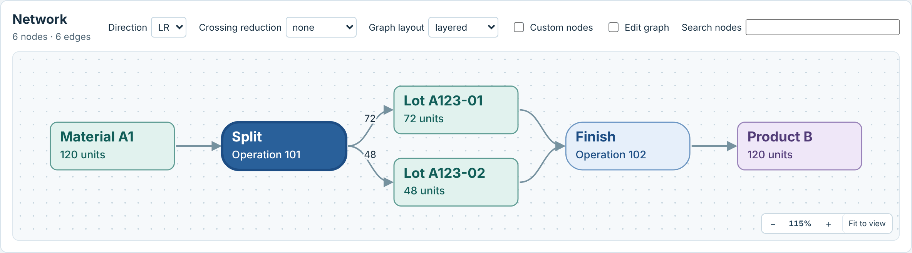
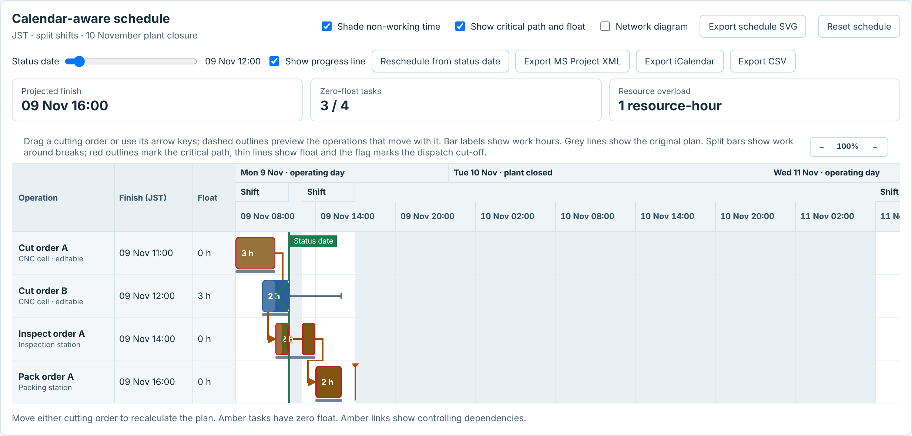
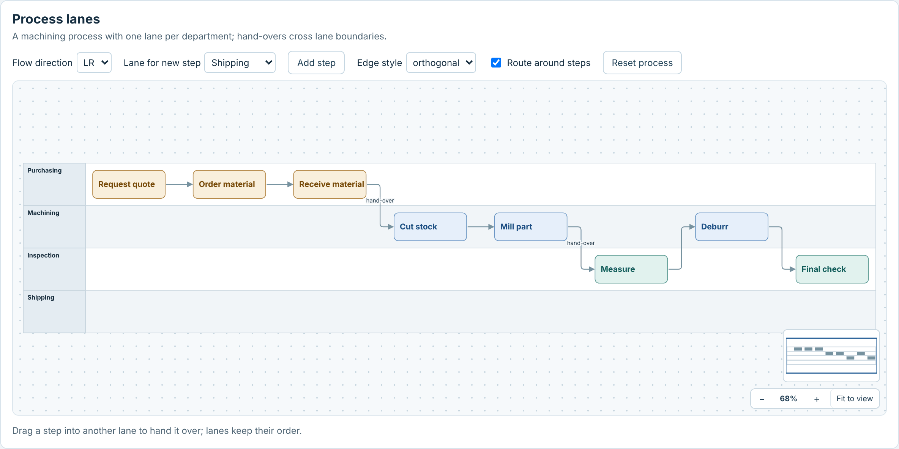
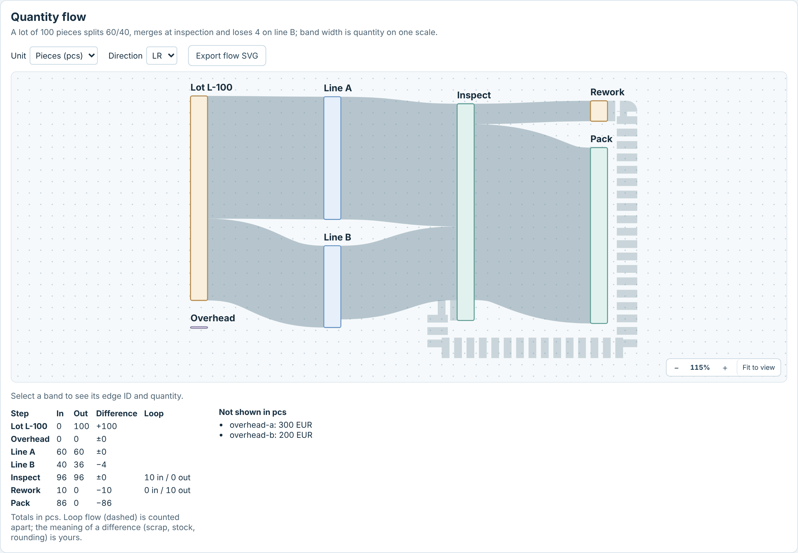
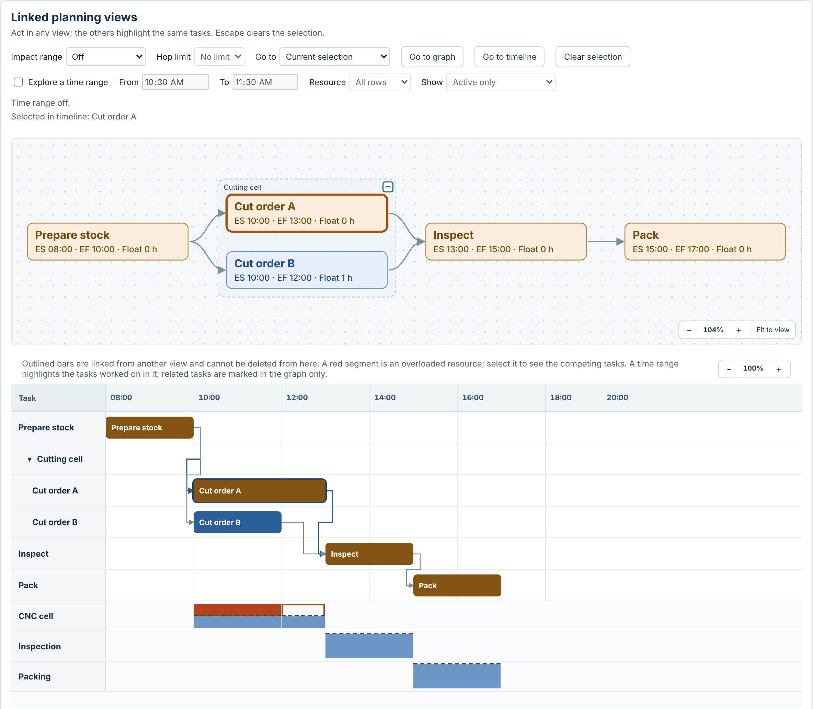
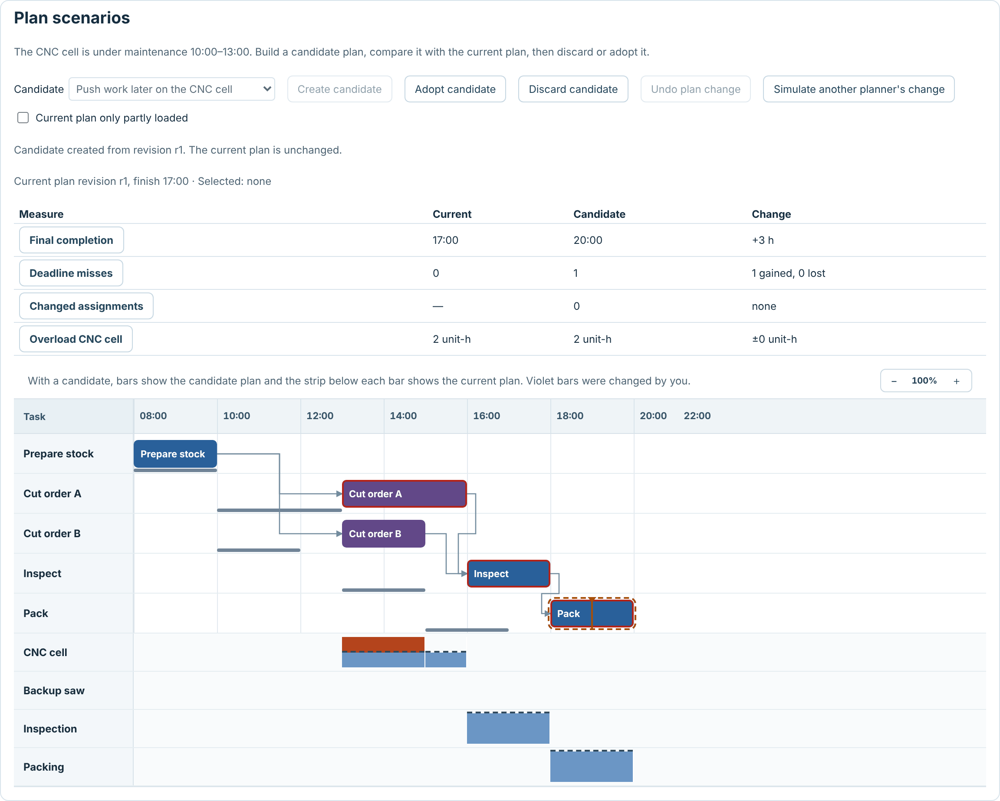
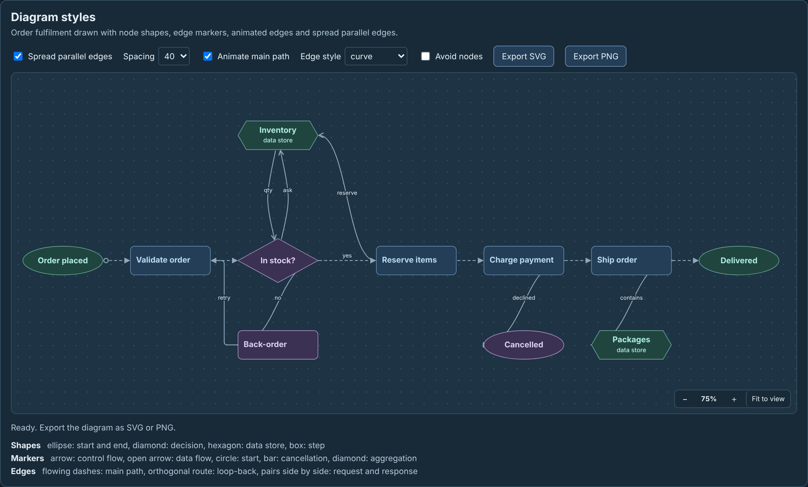

# Vue Weave

[](https://github.com/EightKK/vue-weave/actions/workflows/ci.yml) [](https://github.com/EightKK/vue-weave/blob/v1.1.0/LICENSE)

[English](https://github.com/EightKK/vue-weave/blob/v1.1.0/README.md)

[デモを試す](https://eightkk.github.io/vue-weave/) · [ソースコード](https://github.com/EightKK/vue-weave) · [課題・問い合わせ](https://github.com/EightKK/vue-weave/issues) · [リリース](https://github.com/EightKK/vue-weave/releases)

Vue 3でネットワークグラフとガントチャートを実装するためのライブラリです。関係の探索、工程フロー、製造のロット系譜、プロジェクト工程、設備・担当者別の予定などを、型付きの2つのコンポーネントで作れます。グラフ・日程計算・設備負荷の計算は、Node.js、Worker、サーバーでも動くヘッドレスのコアで行えます。

- **制御されたコンポーネント。** `NetworkGraph` と `GanttChart` は渡されたデータを書き換えません。利用者の編集は変更案のイベントになり、反映するかどうかはアプリ側で決めます。
- **計画機能を内蔵。** 稼働カレンダー、依存関係、クリティカルパス、設備負荷と平準化、実績からの再計画、計画シナリオの比較に対応し、各日程が決まった理由も説明できます。
- **必要な機能だけを有効化。** 既定の動作はシンプルなまま、ほかの機能はpropsで有効にします。Vue以外の実行時依存はなく、サーバーサイドレンダリング、SVG・PNGの書き出し、ダークテーマ、右から左のレイアウトに対応します。

## インストール

```sh
npm install @eightkk/vue-weave
```

Vue `^3.5.0` をpeer dependencyとしています。npm 7以降では、アプリケーションにVueがまだなければパッケージと一緒にインストールされます。ES modules、TypeScriptの型定義、スタイルシート1つを提供します。

スタイルシートは、アプリケーションのエントリファイルなどで一度だけ読み込みます。

```ts
import '@eightkk/vue-weave/style.css'
```

Viteではこのままimportできます。`tsconfig.json` で `noUncheckedSideEffectImports` を有効にしている場合や、CSSを扱えないビルド環境の場合は、[The stylesheet and TypeScript](https://github.com/EightKK/vue-weave/blob/v1.1.0/docs/integration.md#the-stylesheet-and-typescript)を参照してください。

**コアだけを使う場合（サーバー・Worker）。** `@eightkk/vue-weave/core` は実行時にVueを必要とせず、Node.js 22.18以降、Worker、サーバーで動作します。ただしVueは必須のpeer dependencyで、optionalなpeerとしては設定していないため、`npm install @eightkk/vue-weave` でVueもインストールされます。コアだけを配備する環境でVueを除くには `--omit=peer` を付けてインストールします。詳しくは[Core only: servers and Workers](https://github.com/EightKK/vue-weave/blob/v1.1.0/docs/integration.md#core-only-servers-and-workers)を参照してください。

**オフラインでのインストール。** 各[GitHub Release](https://github.com/EightKK/vue-weave/releases)には、npmに公開したものと同じパッケージのtarballも添付しています。`eightkk-vue-weave-1.1.0.tgz` をダウンロードし、利用するアプリケーションのフォルダーからインストールします。次のパスは実際のファイルのパスに置き換えます。

```sh
npm install ./eightkk-vue-weave-1.1.0.tgz
```

チェックアウトから[ローカルパッケージを作成](https://github.com/EightKK/vue-weave/blob/v1.1.0/CONTRIBUTING.md#build-a-local-package)することもできます。

## クイックスタート

### ネットワークグラフ

```vue
<script setup lang="ts">
import { ref } from 'vue'
import { NetworkGraph, type NetworkNode, type GraphEdge } from '@eightkk/vue-weave'
import '@eightkk/vue-weave/style.css'

const selected = ref('design')
const nodes: NetworkNode[] = [
  { id: 'design', label: 'Design' },
  { id: 'build', label: 'Build' },
  { id: 'release', label: 'Release' },
]
const edges: GraphEdge[] = [
  { id: 'db', from: 'design', to: 'build' },
  { id: 'br', from: 'build', to: 'release', label: 'Approved' },
]
</script>

<template>
  <NetworkGraph
    v-model:selected-id="selected"
    :nodes="nodes"
    :edges="edges"
    :options="{ direction: 'LR' }"
  />
</template>
```

ほかの機能も、propsと `options` で同じように有効にします。次の例は、右から左へ配置し、辺の交差を減らし、検索結果を強調し、画面外のノードの描画を省略します。

```vue
<NetworkGraph
  ref="graph"
  :nodes="nodes"
  :edges="edges"
  :options="{ direction: 'RL', crossingReduction: 'barycenter' }"
  :match-ids="matches"
  cull-offscreen
/>
```

### ガントチャート

```vue
<script setup lang="ts">
import { ref } from 'vue'
import { GanttChart, type TimelineBar, type TimelineEdit } from '@eightkk/vue-weave'
import '@eightkk/vue-weave/style.css'

const start = Date.parse('2026-11-09T08:00:00Z')
const hour = 3_600_000
const range = { start, end: start + 8 * hour }
const rows = [{ id: 'team', label: 'Engineering' }]
const bars = ref<TimelineBar[]>([
  {
    id: 'build', rowId: 'team', label: 'Build',
    start: start + hour, end: start + 3 * hour,
    editable: true, progress: 0.4,
  },
])

function commit(change: TimelineEdit) {
  bars.value = bars.value.map(bar =>
    bar.id === change.id ? { ...bar, ...change.after } : bar,
  )
}
</script>

<template>
  <GanttChart :rows="rows" :bars="bars" :range="range" @edit="commit" />
</template>
```

コンポーネントはドラッグ中のプレビューを表示し、`edit` イベントで変更案を渡します。呼び出し側が採用した内容を `bars` に反映します。アプリ固有の検証、API保存、非同期の承認処理を組み込めます。同期の `validateEdit` フックでイベント発行前に変更案を拒否することもできます。区間は半開区間 `[start, end)` で、長さ0のバーはマイルストーンです。

### ビューの連動

グラフとガントチャートを連動させる最小の例です。どちらかのビューで項目を選ぶと、そのビューで選択され、もう一方の対応する項目が強調されます。

```vue
<script setup lang="ts">
import { NetworkGraph, GanttChart, useLinkedSelection, type ViewBinding, type ViewTargetEvent } from '@eightkk/vue-weave'

// nodes、edges、rows、bars、range は上の例と同じです。ここではノードIDとバーIDがタスクIDです。
const bindings: ViewBinding[] = bars.value.flatMap(bar => [
  { entity: { kind: 'task', id: bar.id }, target: { view: 'graph', kind: 'node', id: bar.id } },
  { entity: { kind: 'task', id: bar.id }, target: { view: 'timeline', kind: 'bar', id: bar.id } },
])
const linked = useLinkedSelection({ bindings })
const activate = (event: ViewTargetEvent) => linked.select(event.target.view, [event.target])
</script>

<template>
  <NetworkGraph :nodes="nodes" :edges="edges" :selected-ids="linked.graph.value.selectedNodeIds"
    :highlighted-node-ids="linked.graph.value.highlightedNodeIds" @target-activate="activate" />
  <GanttChart :rows="rows" :bars="bars" :range="range" :selected-ids="linked.timeline.value.selectedBarIds"
    :highlighted-bar-ids="linked.timeline.value.highlightedBarIds" @target-activate="activate" />
</template>
```

ホバー、負荷行、折り畳まれた項目への移動は [Linking views](https://github.com/EightKK/vue-weave/blob/v1.1.0/docs/integration.md#linking-views) を、`useEditTransaction` は [Saving through a server](https://github.com/EightKK/vue-weave/blob/v1.1.0/docs/integration.md#saving-through-a-server) を参照してください。

## ギャラリー

画像はすべて、このリポジトリの[デモ](#デモを起動する)の画面です。





<table>
  <tr>
    <td width="50%" valign="top">
      <br>
      <b>スイムレーン。</b>部門や作業区ごとのレーンを指定した順に並べます（<code>layoutSwimlaneGraph</code>、<code>lanes</code>）。
    </td>
    <td width="50%" valign="top">
      <br>
      <b>数量フロー。</b>辺を数量に比例した太さの帯として、図全体で同じ縮尺で描きます（<code>layoutFlowGraph</code>、<code>edgeBands</code>）。
    </td>
  </tr>
  <tr>
    <td width="50%" valign="top">
      <br>
      <b>ビューの連動。</b>一つのビューで選ぶと、グラフ、ガントチャート、負荷行で同じタスクが強調されます（<code>useLinkedSelection</code>）。
    </td>
    <td width="50%" valign="top">
      <br>
      <b>計画シナリオ。</b>候補計画を採用する前に現行計画と比較します（<code>comparePlans</code>）。
    </td>
  </tr>
  <tr>
    <td width="50%" valign="top">
      <br>
      <b>ダイアグラム表現とダークテーマ。</b>ノード形状、辺の端の記号、アニメーションする辺と平行な辺、組み込みのダークテーマ。
    </td>
    <td width="50%" valign="top">
      <b>デモにはほかにも：</b>プロジェクト工程、1,000行のタイムライン、大規模グラフ、タイムライン編集、非同期レイアウト、グラフ分析、未計画タスクを含むリソース計画、模擬サーバーへの保存を伴う編集、表示範囲ごとに読み込む大規模な計画があります。デザインギャラリーでは、両コンポーネントをワークフロービルダー、データベーススキーマ図、組織図、ロードマップ、スプリント計画、客室予約、カレンダー表示の見た目に作り替えています。
    </td>
  </tr>
</table>

## 機能

基本機能以外はすべてオプトインです。ここでは概要を示します。props、イベント、スロット、関数の一覧は [docs/api.md](https://github.com/EightKK/vue-weave/blob/v1.1.0/docs/api.md) に、手順は [docs/integration.md](https://github.com/EightKK/vue-weave/blob/v1.1.0/docs/integration.md) と [docs/scheduling.md](https://github.com/EightKK/vue-weave/blob/v1.1.0/docs/scheduling.md) にあります。

### NetworkGraph

- **レイアウト：** 分岐・合流、閉路、自己ループに対応した標準の階層レイアウト（`LR`・`TB`・`RL`・`BT`。`crossingReduction: 'barycenter'` で交差を削減）。`layout` propでは、木、放射状、円形、格子、同心円、決定的な力学モデルの各配置（`layoutTreeGraph`、`layoutRadialGraph`、`layoutCircularGraph`、`layoutGridGraph`、`layoutConcentricGraph`、`layoutForceGraph`）や、アプリケーションで導入した[ELK.js](https://github.com/EightKK/vue-weave/blob/v1.1.0/docs/integration.md#use-elkjs-for-layout)の結果を使えます。
- **工程レーン：** `layoutSwimlaneGraph` は部門や作業区ごとのレーンを指定した順に並べます。`lanes` propで帯を描き、ミニマップと書き出しにも反映されます。ドラッグしたノードが入るレーンは `graphSwimlaneAt` で判定できます。詳しくは[Swimlanes for process flows](https://github.com/EightKK/vue-weave/blob/v1.1.0/docs/integration.md#swimlanes-for-process-flows)を参照してください。
- **BPMNとフローチャート：** 円・スタジアム・平行四辺形・書類・円柱・データオブジェクトのノード、BPMNのイベント枠線、ゲートウェイ・イベント・タスク種別の記号、小さな図形の下に置くラベル、破線のメッセージフロー、スイムレーンを囲むプール（`pools`）。書き出しにも反映されます。詳しくは[BPMN processes and flowcharts](https://github.com/EightKK/vue-weave/blob/v1.1.0/docs/integration.md#bpmn-processes-and-flowcharts)を参照してください。
- **数量フロー（サンキー図）：** `layoutFlowGraph` は各辺を数量に応じた太さにして図全体で同じ縮尺で描き、ノードごとの流入量・流出量とその差を補正せずに報告します。単位の異なる数量は合算せず、手戻りのループは破線の参照帯にします。`edgeBands` propは「Cut → Inspect: 60 pcs」のような名前付きで帯を描きます。詳しくは[Quantity flows](https://github.com/EightKK/vue-weave/blob/v1.1.0/docs/integration.md#quantity-flows-sankey-diagrams)を参照してください。
- **描画：** 独自のSVGを描く `node`・`edge`・`group`・`minimap-node` スロット、HTMLを表示する `tooltip`・`node-toolbar`・`edge-toolbar` スロット。ひし形・楕円・六角形のノード、直角・直線の辺（`edgeStyle`）、ノードを避ける経路（`avoidNodes`）、経由点、端の記号、アニメーションする辺、平行な辺の振り分け。
- **変更案としての編集：** ノードの移動、型付きのポートルール（`connectionRules`）で検査する接続と接続先のヒント、ラベルのその場編集、矩形・投げ縄による選択、入れ子で折りたためるグループ、ノードのサイズ変更、グリッドへの吸着と整列ガイド、パレットからのドロップ、クリップボード、キーボードによる削除。
- **表示範囲の操作：** ミニマップ、大規模グラフ向けの表示範囲外の描画省略と縮小時の簡略表示、ピンチズーム、検索結果の強調（`matchIds`）、`focusNode(id)`、`fit({ ids })`。
- **ダイアグラムエディタ部品：** `GraphPalette` はノードのテンプレートを並べ、グラフへのドラッグとキーボードでの追加を提供します。`PropertyInspector` は選択中のノードを型付きフィールドで編集します。どちらも変更案をイベントで通知します。詳しくは[Diagram editor parts](https://github.com/EightKK/vue-weave/blob/v1.1.0/docs/integration.md#diagram-editor-parts)を参照してください。

### GanttChart

- **表示：** 複数レーン、進捗率、マイルストーン、ラグのラベル付きのFS/SS/FF/SF依存関係。サマリーの集約バーと、オプトインのサマリー行への依存関係を持つ階層行。差異付きで最大3つの名前付きベースライン。多段見出し、日時マーカー、期間の強調（`markerRanges`）。ステータス日付線とイナズマ線。非稼働時間の網掛け。クリティカルパスの枠線、余裕の線、期限、分割バー。`calculateResourceLoad` の出力をそのまま渡せる設備負荷のヒストグラム（`loadRows`）。
- **変更案としての編集：** ドラッグとキーボードによる移動・伸縮、移動に連動して動くバーのプレビュー（`cascade`）、依存関係の作成と付け替え、複数選択と一括移動、ドラッグによるバーの作成、進捗率のスライダー、削除、行の階層移動、列幅の変更、スケジュール制約のハンドル、型付きのセル編集（`field-edit`）、アプリの一覧からのドロップ（`bar-drop`）。
- **スプレッドシート編集（`spreadsheet`）：** セル範囲の選択、Excel や Google スプレッドシートとのコピー・切り取り・貼り付け、Delete による消去、Ctrl/⌘+D や右下のハンドルによる下方向のコピー、文字入力による編集。操作ごとに一つの `sheet-edit` 変更案として届き、`validateSheetEdit` で一括で却下でき、`applyTimelineSheetEdit` で反映できます。デモには、表からスケジューラーがバー・矢印・クリティカルパスを計算する工程表と、購買申請の承認フローの編集画面があります。
- **時間軸：** ズームプリセット、IANAタイムゾーンとロケールに沿ったカレンダー用プリセット（`calendarZoomPresets`、`intlTimeFormatter`）、非稼働時間を圧縮する時間軸（`createWorkingTimeScale`）、Ctrl+ホイールとピンチによるズーム、現在時刻マーカー、`fitToBars()`。
- **大規模データ：** 行と表示時間範囲の仮想化。表示中の週と行だけを読み込むための `visible-window-change`。

### TaskBoard

- **カンバンボード：** オプトインの3つ目の制御コンポーネント。カードをステータス列に並べ、必要ならスイムレーンで分けます。列にはカード数を表示し、WIP制限を超えると警告します。ポインターとタッチのドラッグ（ドロップ位置の表示と自動スクロール付き）とキーボード（Space、矢印キー、Enter、Escape、ライブリージョンでの読み上げ付き）で `card-move` を提案し、`validateCardMove` で却下でき、`applyBoardCardMove` で適用できます。GanttChart と同じタスクと選択を共有できます。[TaskBoard](https://github.com/EightKK/vue-weave/blob/v1.1.0/docs/api.md#taskboard) を参照してください。

### ヘッドレスコア（`@eightkk/vue-weave/core`）

- **グラフのアルゴリズムと指標：** `topologicalOrder`、`findGraphCycles`、`shortestGraphPath`、`searchGraphNodes`、`filterGraph`、連結成分、次数・媒介・PageRankの各中心性、Louvain法によるコミュニティ検出（`detectGraphCommunities`）と、その結果をグループに変換する `graphCommunityGroups`。
- **日程計算：** `buildWorkPeriods` で作るカレンダー（IANAタイムゾーンを含む）上での `scheduleTasks`。最遅開始、手動・非アクティブ・サマリーのタスク、制約、中断区間、循環や実行不能の診断に対応します。`scheduleTasks(input, { explain: true })` は各タスクの開始が決まった理由をトレースし、`toPlanningDiagnostics` は問題を一覧にします。
- **リソース：** `calculateResourceLoad` と `levelResources`。時間とともに変わる能力（`capacityPeriods`）や、タスクの一部だけを占める割り当て（`workOffset`、`workDuration`）にも対応します。`projectResourceTimeline` はリソース別に計画を表示し、`buildPlacementInput` は未計画タスクを計算から除きます。
- **計画の更新：** `propagateEdit`、`rescheduleFromStatusDate`、`rescheduleFromActuals`（記録した実績を保ち、残りを予測）、そして編集した内容と結果として動いた内容を分けて示す `comparePlans`。詳しくは[Compare plan scenarios](https://github.com/EightKK/vue-weave/blob/v1.1.0/docs/scheduling.md#compare-plan-scenarios)を参照してください。
- **アーンドバリュー：** `computeEarnedValue` はステータス日時点のPV・EV・ACと、SV・CV・SPI・CPI・EAC・ETC・VAC・TCPIをタスク別と合計で計算します。計画価値は稼働カレンダー上で積み上げ、Sカーブ用の累積系列も返します。`rollupEarnedValue` はサマリー行を集計します。詳しくは[Earned value management](https://github.com/EightKK/vue-weave/blob/v1.1.0/docs/scheduling.md#earned-value-management)を参照してください。
- **データ交換：** Microsoft Project XML（カレンダー、リソース、割り当てを含む）、iCalendar、CSVの読み込みと書き出し（`fromMsProjectXml`、`toMsProjectXml`、`fromICalendar`、`toICalendar`、`parseCsv`、`toCsv`）。日程をPERT図にする `scheduleToGraph`。

### ビューの連動・大規模データ・保存

- **ビューの連動：** `useLinkedSelection` はグラフ、ガントチャート、負荷行をエンティティの対応づけで連動させます。`revealNode`、`revealBar`、`revealLinkedTarget` は折り畳まれたグループや行の中も含めて項目へ移動し、`timelineBarsInRange` と `resolveTimeRangeTargets` はある時間範囲に作業していた対象を強調します。詳しくは[Linking views](https://github.com/EightKK/vue-weave/blob/v1.1.0/docs/integration.md#linking-views)を参照してください。
- **大規模データ：** `useWindowedData` はアプリの `load` 関数を通じて表示中の範囲だけを取得し、中断、重複排除、再試行に対応します。グラフ展開ヘルパーと `layoutGraphIncrementally` は、表示中のノードを動かさずにグラフを1ホップずつ読み込みます。`useAsyncGraphLayout` はWorkerでレイアウトを計算し、`routingPolicy="preserve"` はエンジンの配線を保持します。詳しくは[Loading only what is visible](https://github.com/EightKK/vue-weave/blob/v1.1.0/docs/integration.md#loading-only-what-is-visible)を参照してください。
- **表示と保存：** 行を検索・並べ替える `useTimelineView`、Undo／Redoの `useEditHistory`、サーバーのアダプターを通じて版競合も扱いながら保存する `useEditTransaction`、版付きで検証されたJSONとして保存・復元する `serializeWeaveSnapshot` と `restoreWeaveSnapshot`。

### 書き出し・テーマ・アクセシビリティ

- どちらのコンポーネントも `exportSvg(options)` と `exportPng(options)` を提供し、サーバーでは `renderGraphSvg` と `renderTimelineSvg` がSVGを生成します。
- 組み込みのダークテーマ（`vw-theme-dark`）と、`prefers-color-scheme` に従う `vw-theme-auto`。`--vw-*` のCSS変数で見た目を調整できます。強制カラー、モーション低減、印刷にも対応します。
- `dir="rtl"`（または `auto`）による右から左のレイアウト。
- キーボード操作とARIA名を備えています。検証の範囲は[対応状況](#対応状況)を参照してください。

```ts
const svg = chart.value!.exportSvg({ title: 'Plan' })
const png = await chart.value!.exportPng({ scale: 2 })
```

## 対応状況

- **バージョン1.0です。** [セマンティックバージョニング](https://semver.org/lang/ja/)に従い、破壊的変更はメジャーリリースだけで行い、[変更履歴](https://github.com/EightKK/vue-weave/blob/v1.1.0/CHANGELOG.md)の「Breaking changes」に記載します。対象となるもの（エクスポートされた名前と型、props、イベント、スロット、ドキュメントに記載した `--vw-*` 変数、スナップショットの形式）と対象外のもの（エラーメッセージの文言、コンポーネントが出力する `vw-` クラス、DOM構造、サーバーレンダリングのマークアップ）は[Compatibility and versioning](https://github.com/EightKK/vue-weave/blob/v1.1.0/docs/api.md#compatibility-and-versioning)に記載しています。
- **Vue：** 3.x の3.5以降（peer dependency `^3.5.0`）。
- **モジュールとTypeScript：** ESMのみ。型定義は `Bundler` と `NodeNext` の型解決に対応しています。項目の `data` に型を付けられ（`NetworkNode<MyData>`、`TimelineBar<MyData>`）、その型がキャストなしでスロットのpropsやコールバックに渡ります。
- **Node.js：** ヘッドレスの `@eightkk/vue-weave/core`、サーバーサイドレンダリング、開発には22.18以降が必要です。
- **ブラウザー：** 最新の主要ブラウザー（Chrome、Edge、Firefox、Safari）。自動ブラウザーテストはChromiumのみで実行するため、ほかのブラウザーはCIの対象外です。
- **アクセシビリティ：** キーボード操作とARIA名を備えています。専用のスクリーンリーダーでの検証はまだ行っていません（[構成、性能上の扱い、対応範囲](https://github.com/EightKK/vue-weave/blob/v1.1.0/docs/architecture.md)を参照）。十分に対応していると想定しないでください。

## デモを起動する

デモは[GitHub Pages](https://eightkk.github.io/vue-weave/)で公開しています。`main`から再ビルドされるため、最新リリースより新しい内容のことがあります。ローカルで起動するには、Node.js 22.18以降とnpmを用意します。cloneしたソースやGitHubのソースZIPのフォルダーで次を実行します。

```sh
npm ci
npm run build:demo
npm start
```

トップページでは「製造計画」と「ロットの流れ」を試せます。ほかの作例は「サンプル集」から開けます。

サンプル集には例ごとのページ（[ギャラリー](#ギャラリー)を参照）、書き出しボタン、テーマ切り替え、採用済みの変更を戻す **Undo**／**Redo** があります。**Edit graph** や **Planning overlays** などの切り替えで、上記のオプトイン機能を試せます。**Design gallery** の行では、同じ2つのコンポーネントをスロット、`--vw-*` 変数、`vw-` クラスだけで作り替えています。編集結果はデモ画面内の状態として保持します。デモの未計画一覧、インスペクター、診断一覧、ツールバーは `examples/components/` の参考実装で、パッケージには含まれません。

Windowsでは代わりに `Start.cmd` をダブルクリックしても起動できます。`preview/` が現在のソースからビルドされたものであればそのまま表示し、そうでなければ先にビルドします。インストール済みの依存関係が `package-lock.json` と一致しない場合は、ビルドの前に `npm ci` も実行します。`npm start` は `preview/` をそのまま表示します。

`preview/` を含むビルド済みデモのアーカイブ（リリースに添付されることがあります）を使う場合は、全体を展開して `npm start` を実行するか、Windowsで `Start.cmd` をダブルクリックします。ビルド済みデモはNode.jsがあれば依存関係のインストールなしで起動できます。ソースを変更した場合は `Start.cmd` がデモをビルドし直します。初回はnpmとインターネット接続が必要です。

開発・検証コマンドは[Contributing](https://github.com/EightKK/vue-weave/blob/v1.1.0/CONTRIBUTING.md)を参照してください。

## ドキュメント

API、コメント、詳細ドキュメントは英語です。

- [入力型と公開API](https://github.com/EightKK/vue-weave/blob/v1.1.0/docs/api.md)
- [Vue・Nuxtへの組み込み、独自描画、時間軸、保存処理](https://github.com/EightKK/vue-weave/blob/v1.1.0/docs/integration.md)
- [構成、性能上の扱い、対応範囲](https://github.com/EightKK/vue-weave/blob/v1.1.0/docs/architecture.md)
- [日程計算と設備負荷](https://github.com/EightKK/vue-weave/blob/v1.1.0/docs/scheduling.md)
- [開発とリリース手順](https://github.com/EightKK/vue-weave/blob/v1.1.0/CONTRIBUTING.md)
- [セキュリティ方針と脆弱性の非公開報告](https://github.com/EightKK/vue-weave/blob/v1.1.0/docs/security.md)
- [行動規範](https://github.com/EightKK/vue-weave/blob/v1.1.0/docs/code-of-conduct.md)
- [変更履歴](https://github.com/EightKK/vue-weave/blob/v1.1.0/CHANGELOG.md)

## ライセンス

MITです。[LICENSE](https://github.com/EightKK/vue-weave/blob/v1.1.0/LICENSE) を参照してください。ビルド済みデモの第三者ライセンス表示は [THIRD_PARTY_NOTICES.md](https://github.com/EightKK/vue-weave/blob/v1.1.0/THIRD_PARTY_NOTICES.md) と [Third-party licenses](https://github.com/EightKK/vue-weave/blob/v1.1.0/docs/third-party-licenses.md) にあります。
