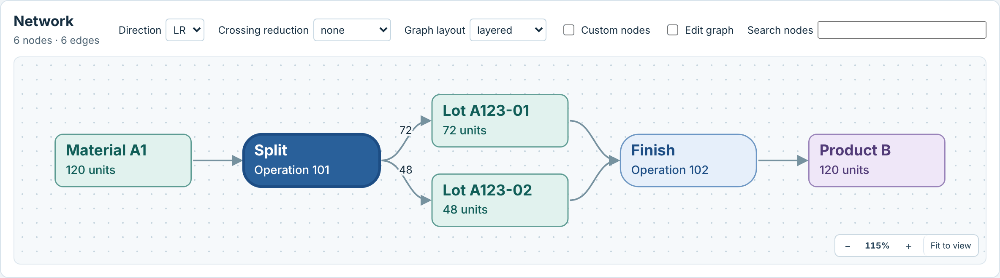
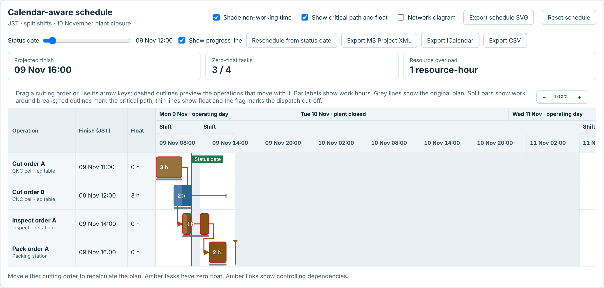
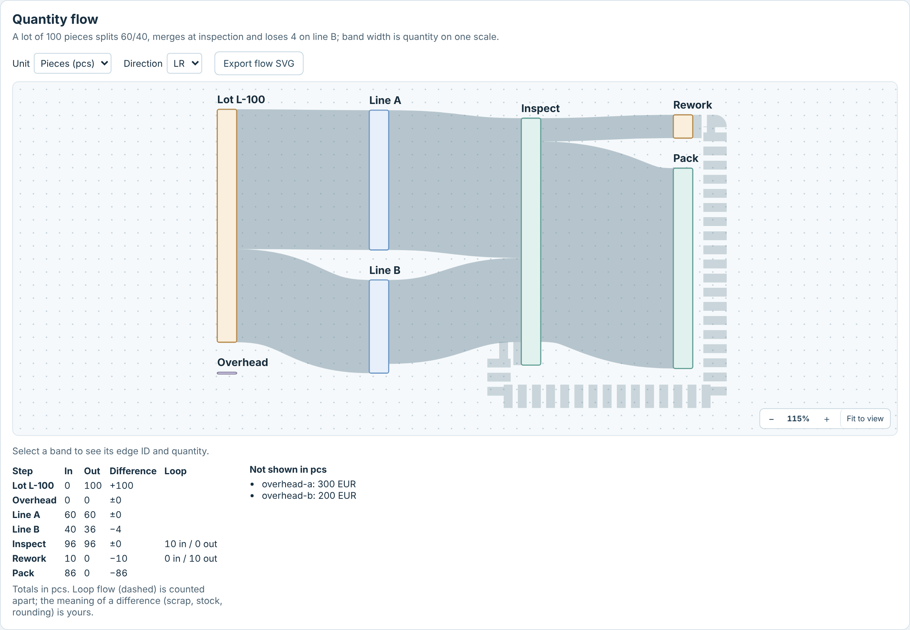
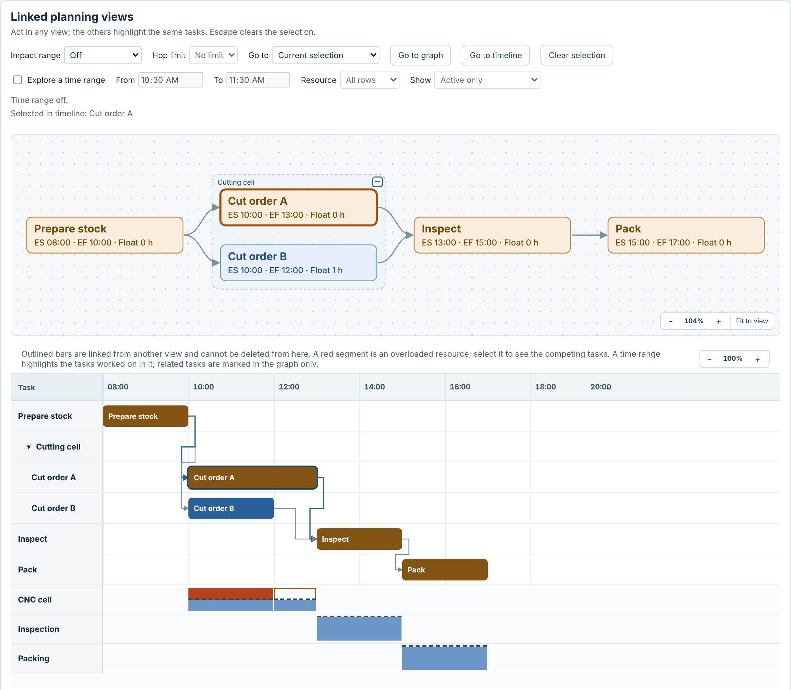
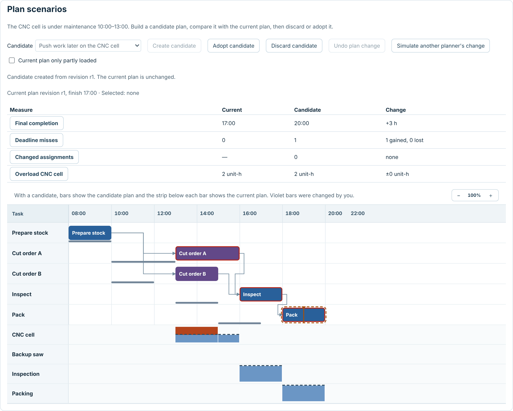

# Vue Weave

[](https://github.com/EightKK/vue-weave/actions/workflows/ci.yml) [](https://github.com/EightKK/vue-weave/blob/v1.0.0/LICENSE)

[日本語](https://github.com/EightKK/vue-weave/blob/v1.0.0/README.ja.md)

[Interactive demo](https://eightkk.github.io/vue-weave/) · [Source](https://github.com/EightKK/vue-weave) · [Issues](https://github.com/EightKK/vue-weave/issues) · [Releases](https://github.com/EightKK/vue-weave/releases)

Interactive network graphs and Gantt charts for Vue 3. Build relationship explorers, process flows, production views, project schedules and resource timelines from two typed components, and do the graph, scheduling and resource-load calculations in a headless core that also runs in Node.js, workers and on servers.

- **Two controlled components.** `NetworkGraph` and `GanttChart` never change your data. A user edit becomes a proposal event, and your code decides whether to apply it.
- **Planning built in.** Calendars, dependencies, critical path, resource load and leveling, recorded actuals and plan scenario comparison, with an explanation of every date.
- **Opt-in features.** The defaults stay simple; everything else is a prop. No runtime dependencies besides Vue, server-side rendering, SVG and PNG export, a dark theme and right-to-left layouts.

## Install

```sh
npm install @eightkk/vue-weave
```

Vue `^3.5.0` is a peer dependency. npm 7 and later install it together with the package when your application does not have it yet. The package ships ES modules, TypeScript declarations and one stylesheet.

Import the stylesheet once, for example in your application's entry file:

```ts
import '@eightkk/vue-weave/style.css'
```

Vite handles this import as it is. If your `tsconfig.json` enables `noUncheckedSideEffectImports`, or your build has no CSS loader, see [The stylesheet and TypeScript](https://github.com/EightKK/vue-weave/blob/v1.0.0/docs/integration.md#the-stylesheet-and-typescript).

**Core only (servers and Workers).** `@eightkk/vue-weave/core` runs without Vue at runtime, in Node.js 22.18+, Workers and on servers. Vue is still a required peer dependency (an optional peer is not configured), so `npm install @eightkk/vue-weave` installs Vue as well. To leave it out of a core-only deployment, install with `--omit=peer`. See [Core only: servers and Workers](https://github.com/EightKK/vue-weave/blob/v1.0.0/docs/integration.md#core-only-servers-and-workers).

**Offline install.** Each [GitHub Release](https://github.com/EightKK/vue-weave/releases) also has the package tarball, the same file that is published to npm. Download `eightkk-vue-weave-1.0.0.tgz` and install it from your application's directory, replacing the example path with the actual one:

```sh
npm install ./eightkk-vue-weave-1.0.0.tgz
```

You can also [build a local package](https://github.com/EightKK/vue-weave/blob/v1.0.0/CONTRIBUTING.md#build-a-local-package) from a checkout.

## Quick start

### A network graph

```vue
<script setup lang="ts">
import { ref } from 'vue'
import { NetworkGraph, type NetworkNode, type GraphEdge } from '@eightkk/vue-weave'
import '@eightkk/vue-weave/style.css'

const selected = ref('design')
const nodes: NetworkNode[] = [
  { id: 'design', label: 'Design' },
  { id: 'build', label: 'Build' },
  { id: 'release', label: 'Release' },
]
const edges: GraphEdge[] = [
  { id: 'db', from: 'design', to: 'build' },
  { id: 'br', from: 'build', to: 'release', label: 'Approved' },
]
</script>

<template>
  <NetworkGraph
    v-model:selected-id="selected"
    :nodes="nodes"
    :edges="edges"
    :options="{ direction: 'LR' }"
  />
</template>
```

Other features are enabled the same way, through props and `options`. For example, this graph flows right to left, reduces edge crossings, highlights search matches and skips drawing off-screen nodes:

```vue
<NetworkGraph
  ref="graph"
  :nodes="nodes"
  :edges="edges"
  :options="{ direction: 'RL', crossingReduction: 'barycenter' }"
  :match-ids="matches"
  cull-offscreen
/>
```

### A controlled Gantt chart

```vue
<script setup lang="ts">
import { ref } from 'vue'
import { GanttChart, type TimelineBar, type TimelineEdit } from '@eightkk/vue-weave'
import '@eightkk/vue-weave/style.css'

const start = Date.parse('2026-11-09T08:00:00Z')
const hour = 3_600_000
const range = { start, end: start + 8 * hour }
const rows = [{ id: 'team', label: 'Engineering' }]
const bars = ref<TimelineBar[]>([
  {
    id: 'build', rowId: 'team', label: 'Build',
    start: start + hour, end: start + 3 * hour,
    editable: true, progress: 0.4,
  },
])

function commit(change: TimelineEdit) {
  bars.value = bars.value.map(bar =>
    bar.id === change.id ? { ...bar, ...change.after } : bar,
  )
}
</script>

<template>
  <GanttChart :rows="rows" :bars="bars" :range="range" @edit="commit" />
</template>
```

The component previews pointer edits, then emits a proposal. The parent commits it by replacing the affected interval. This supports application-specific validation, API persistence and asynchronous approval. A synchronous `validateEdit` hook can reject a proposal before the event is emitted. Intervals are half-open `[start, end)`, and a zero-duration bar is a milestone.

### Linked views

A minimal link between a graph and a Gantt chart: activating an item in either view selects it there and highlights its counterpart in the other.

```vue
<script setup lang="ts">
import { NetworkGraph, GanttChart, useLinkedSelection, type ViewBinding, type ViewTargetEvent } from '@eightkk/vue-weave'

// nodes, edges, rows, bars and range as in the examples above; node and bar IDs are task IDs here.
const bindings: ViewBinding[] = bars.value.flatMap(bar => [
  { entity: { kind: 'task', id: bar.id }, target: { view: 'graph', kind: 'node', id: bar.id } },
  { entity: { kind: 'task', id: bar.id }, target: { view: 'timeline', kind: 'bar', id: bar.id } },
])
const linked = useLinkedSelection({ bindings })
const activate = (event: ViewTargetEvent) => linked.select(event.target.view, [event.target])
</script>

<template>
  <NetworkGraph :nodes="nodes" :edges="edges" :selected-ids="linked.graph.value.selectedNodeIds"
    :highlighted-node-ids="linked.graph.value.highlightedNodeIds" @target-activate="activate" />
  <GanttChart :rows="rows" :bars="bars" :range="range" :selected-ids="linked.timeline.value.selectedBarIds"
    :highlighted-bar-ids="linked.timeline.value.highlightedBarIds" @target-activate="activate" />
</template>
```

See [Linking views](https://github.com/EightKK/vue-weave/blob/v1.0.0/docs/integration.md#linking-views) for hover, load rows and moving to collapsed items, and [Saving through a server](https://github.com/EightKK/vue-weave/blob/v1.0.0/docs/integration.md#saving-through-a-server) for `useEditTransaction`.

## Gallery

All screenshots are from the [demo app](#run-the-demo) in this repository.





<table>
  <tr>
    <td width="50%" valign="top">
      <br>
      <b>Swimlanes.</b> One lane per department or work centre, in your order (<code>layoutSwimlaneGraph</code>, <code>lanes</code>).
    </td>
    <td width="50%" valign="top">
      <br>
      <b>Quantity flows.</b> Edges drawn as bands as wide as their quantity, on one scale (<code>layoutFlowGraph</code>, <code>edgeBands</code>).
    </td>
  </tr>
  <tr>
    <td width="50%" valign="top">
      <br>
      <b>Linked views.</b> Select in one view and the graph, Gantt chart and load rows highlight the same task (<code>useLinkedSelection</code>).
    </td>
    <td width="50%" valign="top">
      <br>
      <b>Plan scenarios.</b> Compare a candidate plan with the current one before adopting it (<code>comparePlans</code>).
    </td>
  </tr>
  <tr>
    <td width="50%" valign="top">
      <br>
      <b>Diagram styles and dark theme.</b> Node shapes, edge markers, animated and parallel edges, and the built-in dark theme.
    </td>
    <td width="50%" valign="top">
      <b>More in the demo:</b> project delivery, a 1,000-row timeline, a large graph, timeline editing, an asynchronous layout, graph analysis, resource planning with unplanned tasks, saved editing against a simulated server, a large plan loaded window by window, and a design gallery that restyles both components as a workflow builder, a database schema, an org chart, a roadmap, a sprint plan, room bookings and calendar views.
    </td>
  </tr>
</table>

## Features

Everything beyond the basics is opt-in. This is an overview; the full list of props, events, slots and functions is in [docs/api.md](https://github.com/EightKK/vue-weave/blob/v1.0.0/docs/api.md), with guides in [docs/integration.md](https://github.com/EightKK/vue-weave/blob/v1.0.0/docs/integration.md) and [docs/scheduling.md](https://github.com/EightKK/vue-weave/blob/v1.0.0/docs/scheduling.md).

### NetworkGraph

- **Layouts:** a built-in layered layout (`LR`, `TB`, `RL` or `BT`, with `crossingReduction: 'barycenter'`) that handles branches, merges, cycles and self-loops. Through the `layout` prop: tree, radial, circular, grid, concentric and deterministic force layouts (`layoutTreeGraph`, `layoutRadialGraph`, `layoutCircularGraph`, `layoutGridGraph`, `layoutConcentricGraph`, `layoutForceGraph`), or [ELK.js](https://github.com/EightKK/vue-weave/blob/v1.0.0/docs/integration.md#use-elkjs-for-layout) installed by your application.
- **Process lanes:** `layoutSwimlaneGraph` gives each department or work centre a lane in your order; the `lanes` prop draws the bands, also in the minimap and exports, and `graphSwimlaneAt` finds the lane a node was dragged to. See [Swimlanes for process flows](https://github.com/EightKK/vue-weave/blob/v1.0.0/docs/integration.md#swimlanes-for-process-flows).
- **Quantity flows (Sankey diagrams):** `layoutFlowGraph` sizes each edge by its quantity on one scale, reports inflow, outflow and their difference per node as given, never adds different units, and draws rework loops as dashed reference bands; the `edgeBands` prop renders them with names such as "Cut → Inspect: 60 pcs". See [Quantity flows](https://github.com/EightKK/vue-weave/blob/v1.0.0/docs/integration.md#quantity-flows-sankey-diagrams).
- **Drawing:** `node`, `edge`, `group` and `minimap-node` slots for your own SVG, `tooltip`, `node-toolbar` and `edge-toolbar` slots for HTML; diamond, ellipse and hexagon nodes; orthogonal or straight edges (`edgeStyle`), routes around nodes (`avoidNodes`), waypoints, end markers, animated edges and spread parallel edges.
- **Editing as proposals:** node moves, connections checked against typed port rules (`connectionRules`) with valid-target hints, inline label editing, box or lasso selection, nested and collapsible groups, node resizing, snap to grid with alignment guides, palette drops, clipboard, and keyboard deletion.
- **Navigation:** minimap, viewport culling and level of detail for large graphs, pinch zoom, search highlighting (`matchIds`), `focusNode(id)` and `fit({ ids })`.

### GanttChart

- **Spreadsheet editing (unreleased):** select a rectangle, copy and paste spreadsheet cells, or fill down with the corner handle. Commit a whole operation with one `sheet-edit` event. The demo homepage includes an editable schedule sheet and a purchase approval workflow.

- **Display:** multiple lanes, progress, milestones and FS/SS/FF/SF dependencies with lag labels; row groups with summary rollups and optional summary dependencies; up to three named baseline sets with variance; header bands, date markers and highlighted ranges (`markerRanges`); a status-date line and progress line; non-working time shading; critical outlines, float lines, deadlines and split bars; a resource load histogram (`loadRows`) that accepts `calculateResourceLoad` output.
- **Editing as proposals:** drag and keyboard moves and resizes, auto-scheduling previews of the bars a move would push (`cascade`), dependency creation and reconnection, multiple selection and batch moves, drag to create, progress sliders, deletion, row hierarchy moves, column resizing, scheduling constraint handles, typed cell editors (`field-edit`), and drops from your own lists (`bar-drop`).
- **Time scales:** zoom presets, ready calendar presets in an IANA time zone and locale (`calendarZoomPresets`, `intlTimeFormatter`), a scale that compresses non-working time (`createWorkingTimeScale`), Ctrl+wheel and pinch zoom, a now marker and `fitToBars()`.
- **Scale:** row and time-window virtualization, and `visible-window-change` to load only the visible weeks and rows.

### Headless core (`@eightkk/vue-weave/core`)

- **Graph algorithms and metrics:** `topologicalOrder`, `findGraphCycles`, `shortestGraphPath`, `searchGraphNodes`, `filterGraph`, connected components, degree, betweenness and PageRank centrality, and Louvain communities (`detectGraphCommunities`) that `graphCommunityGroups` turns into groups.
- **Scheduling:** `scheduleTasks` on calendars from `buildWorkPeriods`, including IANA time zones, as-late-as-possible, manual, inactive and summary tasks, constraints, pauses and cycle and infeasibility diagnostics. `scheduleTasks(input, { explain: true })` traces why each task starts when it does, and `toPlanningDiagnostics` lists the problems.
- **Resources:** `calculateResourceLoad` and `levelResources`, with capacity that changes over time (`capacityPeriods`) and assignments that cover only part of a task (`workOffset`, `workDuration`); `projectResourceTimeline` shows a plan by resource, and `buildPlacementInput` keeps unplanned tasks out of the calculation.
- **Plan updates:** `propagateEdit`, `rescheduleFromStatusDate`, `rescheduleFromActuals` (keeps recorded actuals and forecasts the rest), and `comparePlans`, which separates what you changed from what moved as a result. See [Compare plan scenarios](https://github.com/EightKK/vue-weave/blob/v1.0.0/docs/scheduling.md#compare-plan-scenarios).
- **Interchange:** Microsoft Project XML (including calendars, resources and assignments), iCalendar and CSV import and export (`fromMsProjectXml`, `toMsProjectXml`, `fromICalendar`, `toICalendar`, `parseCsv`, `toCsv`), and `scheduleToGraph` for a PERT network diagram.

### Linked views, large data and saving

- **Linked views:** `useLinkedSelection` links a graph, a Gantt chart and load rows through entity bindings; `revealNode`, `revealBar` and `revealLinkedTarget` move to an item, also inside collapsed groups and rows; `timelineBarsInRange` and `resolveTimeRangeTargets` highlight what was worked on in a time range. See [Linking views](https://github.com/EightKK/vue-weave/blob/v1.0.0/docs/integration.md#linking-views).
- **Large data:** `useWindowedData` fetches only the visible window through your `load` function, with aborts, deduplication and retry; graph expansion helpers and `layoutGraphIncrementally` load a graph one hop at a time without moving the nodes on display; `useAsyncGraphLayout` runs a layout in a Worker, and `routingPolicy="preserve"` keeps the engine's routes. See [Loading only what is visible](https://github.com/EightKK/vue-weave/blob/v1.0.0/docs/integration.md#loading-only-what-is-visible).
- **Views and saving:** `useTimelineView` for searched and sorted rows, `useEditHistory` for undo and redo, `useEditTransaction` to save through your server adapter with conflict handling, and `serializeWeaveSnapshot` and `restoreWeaveSnapshot` for versioned, validated JSON.

### Export, themes and accessibility

- `exportSvg(options)` and `exportPng(options)` on both components, and `renderGraphSvg` and `renderTimelineSvg` for SVG on a server.
- A built-in dark theme (`vw-theme-dark`) and `vw-theme-auto`, which follows `prefers-color-scheme`; theming through `--vw-*` CSS variables; forced colors, reduced motion and print styles.
- Right-to-left layouts with `dir="rtl"` (or `auto`).
- Keyboard operation and ARIA names are built in; see [Status and support](#status-and-support) for what has been tested.

```ts
const svg = chart.value!.exportSvg({ title: 'Plan' })
const png = await chart.value!.exportPng({ scale: 2 })
```

## Status and support

- **Version 1.0.** Releases follow [Semantic Versioning](https://semver.org/): breaking changes are made only in major releases and are listed under "Breaking changes" in the [changelog](https://github.com/EightKK/vue-weave/blob/v1.0.0/CHANGELOG.md). [Compatibility and versioning](https://github.com/EightKK/vue-weave/blob/v1.0.0/docs/api.md#compatibility-and-versioning) lists what that covers (exported names and types, props, events, slots, documented `--vw-*` properties and the snapshot format) and what it does not (the exact text of error messages, the emitted `vw-` classes, DOM structure and server-rendered markup).
- **Vue:** 3.5 or later in 3.x (peer dependency `^3.5.0`).
- **Modules and TypeScript:** ESM only. Declarations support `Bundler` and `NodeNext` resolution. Item `data` can be typed (`NetworkNode<MyData>`, `TimelineBar<MyData>`), and that type reaches slot props and callbacks without casts.
- **Node.js:** 22.18 or later for the headless `@eightkk/vue-weave/core` entry, server-side rendering and development.
- **Browsers:** current evergreen browsers (Chrome, Edge, Firefox and Safari). Automated browser tests run in Chromium only, so the other browsers are not covered by CI.
- **Accessibility:** keyboard operation and ARIA names are included. Dedicated screen-reader testing has not been done yet (see [Architecture, performance and scope](https://github.com/EightKK/vue-weave/blob/v1.0.0/docs/architecture.md)), so do not assume full conformance.

## Run the demo

The main page opens the production planning and lot flow demos. Use **Examples** to open the full sample gallery.

The demo is hosted on [GitHub Pages](https://eightkk.github.io/vue-weave/) and is rebuilt from `main`, so it can be ahead of the latest release. To run it locally, use Node.js 22.18+ and npm. From a source checkout or GitHub source ZIP, run:

```sh
npm ci
npm run build:demo
npm start
```

The demo has one page per example (listed under [Gallery](#gallery)), export buttons, a theme switch, and **Undo** and **Redo** for accepted edits. Toggles such as **Edit graph** and **Planning overlays** turn on the opt-in features described above. The **Design gallery** row restyles the same two components using only slots, `--vw-*` variables and `vw-` classes. Edits remain in the demo's local state. The backlog, inspector, diagnostics list and toolbar of the demo are examples in `examples/components/`, not part of the package.

On Windows you can double-click `Start.cmd` instead. It serves `preview/` when it was built from the current sources, and otherwise builds it first, running `npm ci` beforehand if the installed dependencies do not match `package-lock.json`. `npm start` serves `preview/` as it is.

If you have a prebuilt demo archive containing `preview/` (it may be attached to a release), extract it completely and run `npm start`, or double-click `Start.cmd` on Windows. The prebuilt demo needs Node.js but does not require dependency installation. If you change its sources, `Start.cmd` rebuilds it, which needs npm and an internet connection the first time.

For development and verification commands, see [Contributing](https://github.com/EightKK/vue-weave/blob/v1.0.0/CONTRIBUTING.md).

## Documentation

- [Public API and input contracts](https://github.com/EightKK/vue-weave/blob/v1.0.0/docs/api.md)
- [Vue, Nuxt, custom rendering, time scales and persistence](https://github.com/EightKK/vue-weave/blob/v1.0.0/docs/integration.md)
- [Architecture, performance and scope](https://github.com/EightKK/vue-weave/blob/v1.0.0/docs/architecture.md)
- [Scheduling and resource load](https://github.com/EightKK/vue-weave/blob/v1.0.0/docs/scheduling.md)
- [Contributing and release process](https://github.com/EightKK/vue-weave/blob/v1.0.0/CONTRIBUTING.md)
- [Security and private vulnerability reporting](https://github.com/EightKK/vue-weave/blob/v1.0.0/docs/security.md)
- [Code of conduct](https://github.com/EightKK/vue-weave/blob/v1.0.0/docs/code-of-conduct.md)
- [Changelog](https://github.com/EightKK/vue-weave/blob/v1.0.0/CHANGELOG.md)

## License

MIT. See [LICENSE](https://github.com/EightKK/vue-weave/blob/v1.0.0/LICENSE). Third-party notices for the prebuilt demo are in [THIRD_PARTY_NOTICES.md](https://github.com/EightKK/vue-weave/blob/v1.0.0/THIRD_PARTY_NOTICES.md) and [Third-party licenses](https://github.com/EightKK/vue-weave/blob/v1.0.0/docs/third-party-licenses.md).
