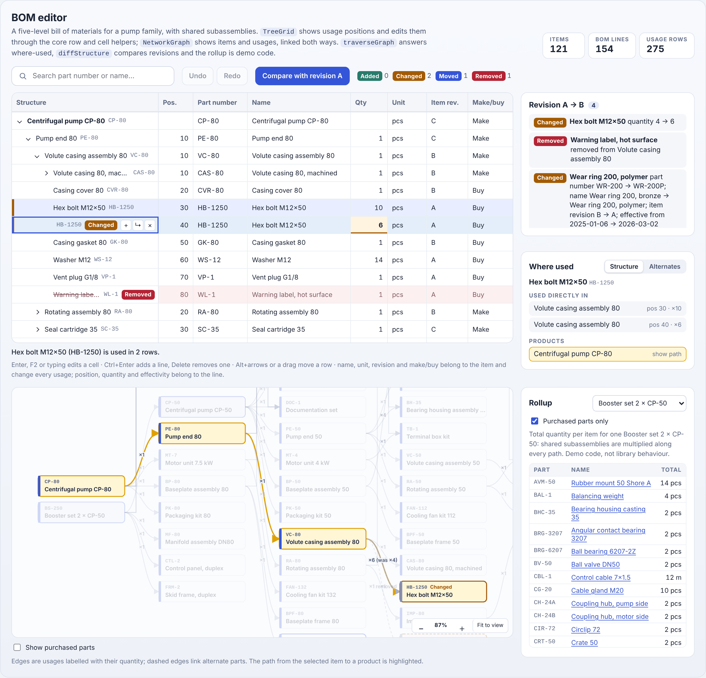
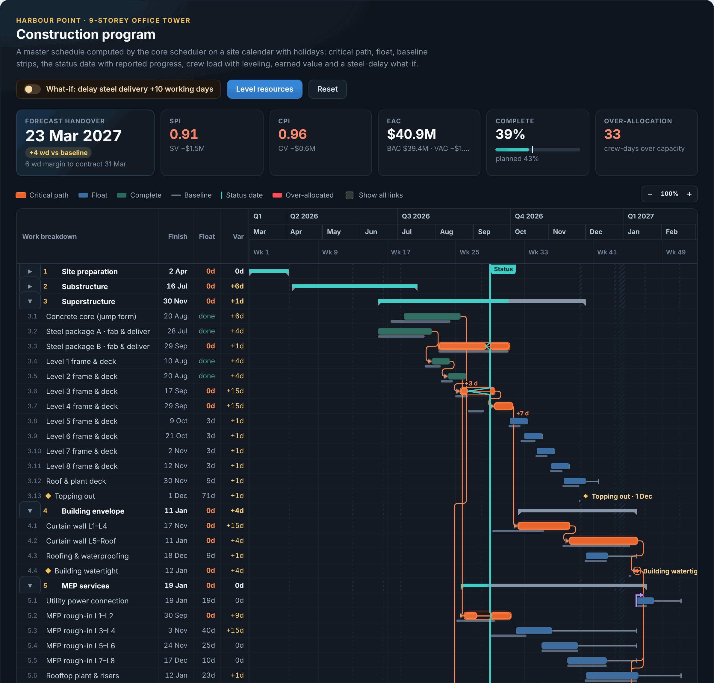

# Vue Weave

[](https://github.com/EightKK/vue-weave/actions/workflows/ci.yml) [](https://www.npmjs.com/package/@eightkk/vue-weave) [](https://github.com/EightKK/vue-weave/blob/v1.4.0/LICENSE)

[日本語](https://github.com/EightKK/vue-weave/blob/v1.4.0/README.ja.md)

**[Website](https://eightkk.github.io/vue-weave/)** · [Getting started](https://eightkk.github.io/vue-weave/learn/) · [Examples](https://eightkk.github.io/vue-weave/examples/) · [Showcase](https://eightkk.github.io/vue-weave/showcase/) · [API reference](https://eightkk.github.io/vue-weave/api/) · [Changelog](https://github.com/EightKK/vue-weave/blob/v1.4.0/CHANGELOG.md)

Interactive network graphs, Gantt charts and tree grids for Vue 3, with a headless core for layout, scheduling and resource planning. Build relationship explorers, process flows, project schedules, resource timelines and bill-of-materials editors from typed, controlled components, and run the graph, scheduling, resource-load and earned value calculations in Node.js, workers and on servers too.

<table>
  <tr>
    <td width="50%" valign="top"><a href="https://eightkk.github.io/vue-weave/showcase/bom/"></a></td>
    <td width="50%" valign="top"><a href="https://eightkk.github.io/vue-weave/showcase/construction/"></a></td>
  </tr>
</table>

- **Controlled components.** `NetworkGraph`, `GanttChart` and the opt-in `TreeGrid`, `TaskBoard`, `EventCalendar`, `GraphPalette` and `PropertyInspector` never change your data. A user edit becomes a proposal event, and your code decides whether to apply it.
- **Planning built in.** Calendars, dependencies, critical path, resource load and leveling, recorded actuals, earned value and plan scenario comparison, with an explanation of every date.
- **Linked views.** Select an entity in a graph, a Gantt chart, a tree grid or your own table, and every other view highlights it.
- **Opt-in features, no runtime dependencies besides Vue.** Server-side rendering, SVG and PNG export, Microsoft Project, iCalendar, CSV, Mermaid, GraphML and draw.io interchange, a dark theme and right-to-left layouts.

## Install

```sh
npm install @eightkk/vue-weave
```

Vue `^3.5.0` is a peer dependency. npm 7 and later install it together with the package when your application does not have it yet. The package ships ES modules, TypeScript declarations and one stylesheet.

Import the stylesheet once, for example in your application's entry file:

```ts
import '@eightkk/vue-weave/style.css'
```

Vite handles this import as it is. If your `tsconfig.json` enables `noUncheckedSideEffectImports`, or your build has no CSS loader, see [The stylesheet and TypeScript](https://github.com/EightKK/vue-weave/blob/v1.4.0/docs/integration.md#the-stylesheet-and-typescript).

**Core only (servers and Workers).** `@eightkk/vue-weave/core` runs without Vue at runtime, in Node.js 22.18+, Workers and on servers. Vue is still a required peer dependency (an optional peer is not configured), so `npm install @eightkk/vue-weave` installs Vue as well. To leave it out of a core-only deployment, install with `--omit=peer`. See [Core only: servers and Workers](https://github.com/EightKK/vue-weave/blob/v1.4.0/docs/integration.md#core-only-servers-and-workers).

**Offline install.** Each [GitHub Release](https://github.com/EightKK/vue-weave/releases) also has the package tarball, the same file that is published to npm. Download `eightkk-vue-weave-1.4.0.tgz` and install it from your application's directory, replacing the example path with the actual one:

```sh
npm install ./eightkk-vue-weave-1.4.0.tgz
```

You can also [build a local package](https://github.com/EightKK/vue-weave/blob/v1.4.0/CONTRIBUTING.md#build-a-local-package) from a checkout.

## Quick start

### A network graph

```vue
<script setup lang="ts">
import { ref } from 'vue'
import { NetworkGraph, type NetworkNode, type GraphEdge } from '@eightkk/vue-weave'
import '@eightkk/vue-weave/style.css'

const selected = ref('design')
const nodes: NetworkNode[] = [
  { id: 'design', label: 'Design' },
  { id: 'build', label: 'Build' },
  { id: 'release', label: 'Release' },
]
const edges: GraphEdge[] = [
  { id: 'db', from: 'design', to: 'build' },
  { id: 'br', from: 'build', to: 'release', label: 'Approved' },
]
</script>

<template>
  <NetworkGraph
    v-model:selected-id="selected"
    :nodes="nodes"
    :edges="edges"
    :options="{ direction: 'LR' }"
  />
</template>
```

### A controlled Gantt chart

```vue
<script setup lang="ts">
import { ref } from 'vue'
import { GanttChart, type TimelineBar, type TimelineEdit } from '@eightkk/vue-weave'
import '@eightkk/vue-weave/style.css'

const start = Date.parse('2026-11-09T08:00:00Z')
const hour = 3_600_000
const range = { start, end: start + 8 * hour }
const rows = [{ id: 'team', label: 'Engineering' }]
const bars = ref<TimelineBar[]>([
  {
    id: 'build', rowId: 'team', label: 'Build',
    start: start + hour, end: start + 3 * hour,
    editable: true, progress: 0.4,
  },
])

function commit(change: TimelineEdit) {
  bars.value = bars.value.map(bar =>
    bar.id === change.id ? { ...bar, ...change.after } : bar,
  )
}
</script>

<template>
  <GanttChart :rows="rows" :bars="bars" :range="range" @edit="commit" />
</template>
```

The component previews pointer edits, then emits a proposal. The parent commits it by replacing the affected interval. This supports application-specific validation, API persistence and asynchronous approval. A synchronous `validateEdit` hook can reject a proposal before the event is emitted. Intervals are half-open `[start, end)`, and a zero-duration bar is a milestone.

### Linked views

A minimal link between a graph and a Gantt chart: activating an item in either view selects it there and highlights its counterpart in the other.

```vue
<script setup lang="ts">
import { NetworkGraph, GanttChart, useLinkedSelection, type ViewBinding, type ViewTargetEvent } from '@eightkk/vue-weave'

// nodes, edges, rows, bars and range as in the examples above; node and bar IDs are task IDs here.
const bindings: ViewBinding[] = bars.value.flatMap(bar => [
  { entity: { kind: 'task', id: bar.id }, target: { view: 'graph', kind: 'node', id: bar.id } },
  { entity: { kind: 'task', id: bar.id }, target: { view: 'timeline', kind: 'bar', id: bar.id } },
])
const linked = useLinkedSelection({ bindings })
const activate = (event: ViewTargetEvent) => linked.select(event.target.view, [event.target])
</script>

<template>
  <NetworkGraph :nodes="nodes" :edges="edges" :selected-ids="linked.graph.value.selectedNodeIds"
    :highlighted-node-ids="linked.graph.value.highlightedNodeIds" @target-activate="activate" />
  <GanttChart :rows="rows" :bars="bars" :range="range" :selected-ids="linked.timeline.value.selectedBarIds"
    :highlighted-bar-ids="linked.timeline.value.highlightedBarIds" @target-activate="activate" />
</template>
```

More in [Getting started](https://eightkk.github.io/vue-weave/learn/) and the [Linked views example](https://eightkk.github.io/vue-weave/examples/linked-views/).

## What is included

| Part | What it does | Docs |
| --- | --- | --- |
| `NetworkGraph` | Layered, tree, radial, force and swimlane layouts, BPMN and flowchart shapes, quantity flows, groups, editing as proposals, minimap and culling for large graphs | [API](https://eightkk.github.io/vue-weave/api/components/network-graph.html) · [Examples](https://eightkk.github.io/vue-weave/examples/#graph) |
| `GanttChart` | Dependencies, baselines, critical path, resource load rows, spreadsheet editing, calendars and time zones, row and time virtualization | [API](https://eightkk.github.io/vue-weave/api/components/gantt-chart.html) · [Examples](https://eightkk.github.io/vue-weave/examples/#timeline) |
| `TreeGrid` | A row tree against columns or a matrix, virtualized in both directions, with cell, spreadsheet and row structure editing | [API](https://eightkk.github.io/vue-weave/api/components/tree-grid.html) · [Examples](https://eightkk.github.io/vue-weave/examples/#tree-grid) |
| `TaskBoard`, `EventCalendar` | Kanban board with WIP limits and swimlanes; day, week and month calendar with resources and recurring events | [TaskBoard](https://eightkk.github.io/vue-weave/api/components/task-board.html) · [EventCalendar](https://eightkk.github.io/vue-weave/api/components/event-calendar.html) |
| `GraphPalette`, `PropertyInspector` | Parts for diagram editors: a shape palette and a typed property panel | [API](https://eightkk.github.io/vue-weave/api/components/diagram-editor.html) |
| Composables | Linked selection, undo and redo, saving through your server, view state, windowed loading, layouts in a worker | [API](https://eightkk.github.io/vue-weave/api/composables.html) |
| `@eightkk/vue-weave/core` | Graph algorithms and traversal, scheduling and leveling, earned value, time buckets, structure diffs, interchange and SVG export, without Vue at runtime | [API](https://eightkk.github.io/vue-weave/api/core/) · [Type reference](https://eightkk.github.io/vue-weave/api/reference/) |

See the [Examples](https://eightkk.github.io/vue-weave/examples/) for every feature running with its source code, and the [Showcase](https://eightkk.github.io/vue-weave/showcase/) for complete applications built from these parts.

## Status and support

- **Stable since 1.0.** Releases follow [Semantic Versioning](https://semver.org/): breaking changes are made only in major releases and are listed under "Breaking changes" in the [changelog](https://github.com/EightKK/vue-weave/blob/v1.4.0/CHANGELOG.md). [Compatibility and versioning](https://github.com/EightKK/vue-weave/blob/v1.4.0/docs/api.md#compatibility-and-versioning) lists what that covers (exported names and types, props, events, slots, documented `--vw-*` properties and the snapshot format) and what it does not (the exact text of error messages, the emitted `vw-` classes, DOM structure and server-rendered markup).
- **Vue:** 3.5 or later in 3.x (peer dependency `^3.5.0`).
- **Modules and TypeScript:** ESM only. Declarations support `Bundler` and `NodeNext` resolution. Item `data` can be typed (`NetworkNode<MyData>`, `TimelineBar<MyData>`), and that type reaches slot props and callbacks without casts.
- **Node.js:** 22.18 or later for the headless `@eightkk/vue-weave/core` entry, server-side rendering and development.
- **Browsers:** current evergreen browsers (Chrome, Edge, Firefox and Safari). Automated browser tests run in Chromium only, so the other browsers are not covered by CI.
- **Accessibility:** keyboard operation and ARIA names are included. Dedicated screen-reader testing has not been done yet (see [Architecture, performance and scope](https://github.com/EightKK/vue-weave/blob/v1.4.0/docs/architecture.md)), so do not assume full conformance.

## Run the website locally

The [website](https://eightkk.github.io/vue-weave/) is rebuilt from `main`, so it can be ahead of the latest release. To run it locally, use Node.js 22.18+ and npm. From a source checkout or GitHub source ZIP, run:

```sh
npm ci
npm run build:demo
npm start
```

`npm start` serves the built site at `http://127.0.0.1:4173/vue-weave/`. On Windows you can double-click `Start.cmd` instead; it rebuilds the site first when its sources changed. A prebuilt site archive attached to a release runs with `npm start` without installing dependencies. The standalone production planning app is at `/vue-weave/demo/`. For development and verification commands, see [Contributing](https://github.com/EightKK/vue-weave/blob/v1.4.0/CONTRIBUTING.md).

## Documentation

The [API reference](https://eightkk.github.io/vue-weave/api/) and [guides](https://eightkk.github.io/vue-weave/learn/) on the website are built from the Markdown files in [`docs/`](https://github.com/EightKK/vue-weave/blob/v1.4.0/docs/), which are also included in the npm package:

- [Public API and input contracts](https://github.com/EightKK/vue-weave/blob/v1.4.0/docs/api.md)
- [Vue, Nuxt, custom rendering, time scales and persistence](https://github.com/EightKK/vue-weave/blob/v1.4.0/docs/integration.md)
- [Architecture, performance and scope](https://github.com/EightKK/vue-weave/blob/v1.4.0/docs/architecture.md)
- [Scheduling and resource load](https://github.com/EightKK/vue-weave/blob/v1.4.0/docs/scheduling.md)
- [Contributing and release process](https://github.com/EightKK/vue-weave/blob/v1.4.0/CONTRIBUTING.md)
- [Security and private vulnerability reporting](https://github.com/EightKK/vue-weave/blob/v1.4.0/docs/security.md)
- [Code of conduct](https://github.com/EightKK/vue-weave/blob/v1.4.0/docs/code-of-conduct.md)
- [Changelog](https://github.com/EightKK/vue-weave/blob/v1.4.0/CHANGELOG.md)

## License

MIT. See [LICENSE](https://github.com/EightKK/vue-weave/blob/v1.4.0/LICENSE). Third-party notices for the prebuilt site are in [THIRD_PARTY_NOTICES.md](https://github.com/EightKK/vue-weave/blob/v1.4.0/THIRD_PARTY_NOTICES.md) and [Third-party licenses](https://github.com/EightKK/vue-weave/blob/v1.4.0/docs/third-party-licenses.md).
